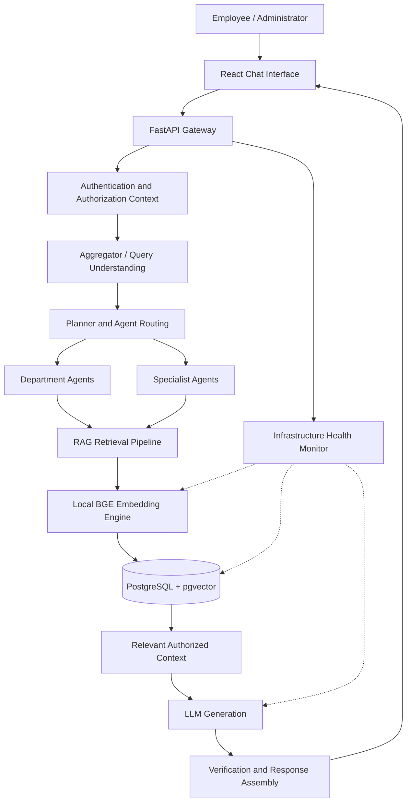
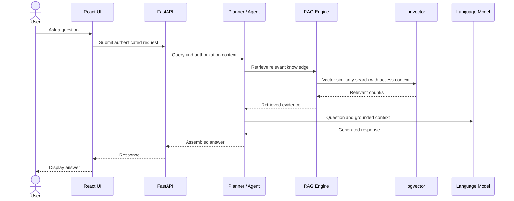
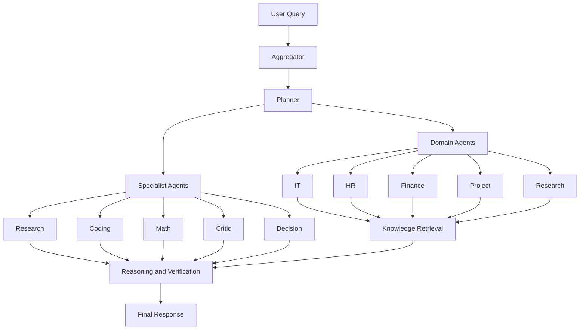
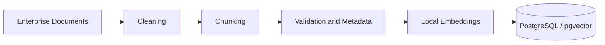
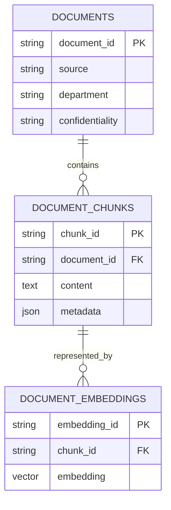
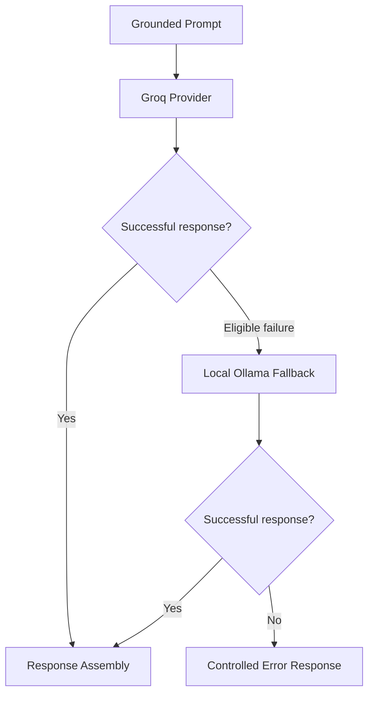

Agentic-RAG-KnowXAI
Intelligent Enterprise Knowledge Assistant powered by Agentic AI and Retrieval-Augmented Generation
     
> From scattered enterprise documents to contextual, intelligent and verifiable answers — through specialized AI agents, vector retrieval and permission-aware knowledge access.
Table of Contents
Overview
Problem Statement
Our Solution
Key Features
System Architecture
How It Works
Multi-Agent Intelligence
RAG Knowledge Pipeline
Embedding Engine
Database Architecture
LLM Reliability
Security and Administration
Technology Stack
Project Structure
Getting Started
Use Cases and Benefits
Testing and Current Status
Future Roadmap
Contributors
Overview
Agentic-RAG-KnowXAI is an enterprise-oriented AI knowledge assistant designed to help employees discover, understand and interact with organizational information using natural language. Unlike a conventional chatbot that relies entirely on a language model's pretrained knowledge, the system combines specialized AI agents, semantic document retrieval, organizational context and large language models to generate relevant answers grounded in a knowledge base.
The project uses a fictional enterprise, MK Infinite AI, as a demonstration environment for departmental policies, standard operating procedures, project documentation and internal knowledge management.
Problem Statement
Organizations accumulate valuable information across policies, manuals, SOPs, reports and departmental documents. Employees often spend significant time searching for the right information. Conventional keyword search struggles with natural-language questions, while standalone language models may produce confident but unsupported answers. Enterprise systems must also account for confidential information, departmental permissions and service reliability.
Our Solution
Agentic-RAG-KnowXAI combines an agent orchestration layer with a retrieval-augmented generation pipeline. It is designed to understand user intent, select an appropriate specialist or domain agent, retrieve relevant organizational knowledge, and produce a contextual response. The design separates a user's authorization context from the intent of their question.
Conventional chatbot	Agentic-RAG-KnowXAI approach
Primarily relies on pretrained knowledge	Retrieves enterprise knowledge before generation
Single general-purpose reasoning path	Specialized agents and planned execution
Limited visibility into answer grounding	Designed for evidence-aware responses
Generic access model	Department and role-aware access design
Single-provider dependency	Groq with Ollama fallback
Key Features
Natural-language enterprise knowledge search and chat.
Agentic orchestration with planning and specialized reasoning.
Department-oriented knowledge retrieval for IT, HR, Finance, Projects and Research.
Local semantic embeddings using BAAI/bge-small-en-v1.5.
PostgreSQL and pgvector-backed semantic search.
Groq LLM integration with local Ollama fallback.
Administrative dashboard and infrastructure health monitoring.
User authentication, role-aware access design and biometric login workflow.
React-based chat interface with conversation history and voice interaction features.
FastAPI backend and containerization support.
System Architecture
The following diagram represents the logical architecture; internal execution may vary by query and configuration.

How It Works
The user authenticates and submits a natural-language question.
The backend establishes the user's identity and authorization context.
The aggregator interprets the query and identifies its intent.
The planner determines the appropriate agent and execution strategy.
The retrieval layer converts the query into a 384-dimensional embedding.
pgvector searches for semantically relevant document chunks.
Access-control metadata is intended to constrain retrieved organizational context.
The selected reasoning and generation components use retrieved evidence to formulate an answer.
Verification and response assembly aim to improve relevance and grounding.
The response is returned to the chat interface.

Multi-Agent Intelligence
The project architecture distinguishes domain expertise from reasoning capabilities.
Domain agent	Responsibility
IT	Technical policies, infrastructure and IT SOPs
HR	Employee policies and organizational procedures
Finance	Financial policies and processes
Project	Project documentation and workflows
Research	Research-oriented organizational knowledge

Specialist agent	Intended responsibility
Research	Evidence discovery and synthesis
Coding	Programming and technical reasoning
Math	Numerical and mathematical reasoning
Critic	Response quality and consistency checks
Decision	Structured decision support

Not every question requires every agent. The architecture is intended to select relevant capabilities rather than execute all agents for every request.
RAG Knowledge Pipeline
Retrieval-Augmented Generation (RAG) supplies relevant external knowledge to a language model at inference time, without requiring the model to be retrained for every document update.
Offline document ingestion

Stage	Purpose
Cleaning	Normalize document content and reduce noise
Chunking	Divide content into retrievable text segments
Validation	Check chunk quality and metadata
Embedding	Convert text into numerical semantic vectors
Ingestion	Store documents, chunks and vectors in the database
Retrieval	Find relevant knowledge at query time
The demonstration knowledge base covers company information, departmental policies and project documentation. Access metadata can include department, access level, allowed departments, confidentiality, version, owner, tenant ID and source.
Embedding Engine
Property	Configuration
Model	BAAI/bge-small-en-v1.5
Vector dimensions	384
Representation	Float32 embeddings
Runtime	Sentence Transformers / PyTorch
Device	CUDA when available, CPU fallback
Storage	pgvector `vector(384)`
Embeddings represent semantic meaning rather than exact keyword overlap. The query embedder validates vectors and supports normalized embeddings. Model caching is used to reduce repeated weight loading.
Direct CPU and CUDA query-embedding tests have produced valid 384-dimensional vectors. Intermittent runtime health-status failures remain under investigation.
Database Architecture
Conceptual entity relationships (not an exact migration schema):

PostgreSQL provides persistent relational storage, while pgvector enables vector similarity operations within the database. Metadata supports the system's permission-aware retrieval design.
LLM Reliability

The Groq–Ollama integration reduces dependence on a single LLM provider. Actual fallback behavior depends on runtime configuration and error handling. Local inference also depends on available model weights and hardware resources.
Security and Administration
The enterprise design includes role-based authorization, departmental context, administrative access and document-level access metadata. A user's department identifies their authorization context; query intent determines the appropriate agent. These are separate concerns.
The administrator interface is designed to support employee management, departmental visibility and infrastructure monitoring. The health dashboard includes database connectivity, embedding availability, vector-dimension consistency and LLM provider checks.
Security practices include keeping API keys in local environment configuration, excluding secrets and backups from Git, and using GitHub push protection. Biometric processing and access enforcement require further security and privacy validation before real enterprise deployment.
Technology Stack
Layer	Technologies
Programming	Python, TypeScript
Frontend	React, Vite
Backend	FastAPI, Uvicorn, Pydantic
Agent orchestration	LangGraph, LangChain
Embedding	Sentence Transformers, PyTorch, BAAI/bge-small-en-v1.5
LLM integration	Groq, Ollama; Gemini and NVIDIA NIM monitored/integrated where configured
Database	PostgreSQL, pgvector, SQLAlchemy
Migrations	Alembic
Testing	pytest
Development and packaging	Git, GitHub, Docker
Project Structure
Selected paths from the project; this is not an exhaustive repository listing.
```text
Agentic-RAG-KnowXAI/
├── agents/
│   └── llm/
│       ├── factory.py
│       └── providers.py
├── api/
│   ├── routes/
│   │   ├── admin.py
│   │   ├── chat.py
│   │   └── system.py
│   └── schemas/
│       └── health.py
├── config/
│   └── settings.py
├── database/
├── migrations/
├── rag/
│   ├── embeddings/
│   ├── ingestion/
│   └── retrieval/
│       └── query_embedder.py
├── services/
│   └── health_service.py
├── frontend/
│   └── src/
│       ├── App.tsx
│       └── admin/
│           └── sections/
│               └── SystemHealthSection.tsx
├── tests/
│   └── test_infrastructure_health.py
├── .gitignore
├── Dockerfile
└── main.py
```
Getting Started
Prerequisites
Python 3.11, Node.js, PostgreSQL with pgvector, Git and the required provider credentials. Ollama and a compatible local model are needed when using local LLM fallback. CUDA is optional.
```bash
git clone https://github.com/themrmk333/Agentic-RAG-KnowXAI.git
cd Agentic-RAG-KnowXAI
git switch feat/admin-health-groq-ollama
```
Windows PowerShell:
```powershell
python -m venv .venv
.\.venv\Scripts\Activate.ps1
```
Install backend dependencies using the repository's dependency manifest and frontend dependencies using its package manifest. Configure the database, apply the appropriate migrations, prepare the embedding model cache and ingest the authorized knowledge base before using RAG.
Configure environment variables according to `config/settings.py` and the repository's configuration documentation. Common required settings include `DATABASE_URL`, `APP_SECRET_KEY`, `EMBEDDING_MODEL` and LLM provider credentials. Never commit actual secret values.
Start the project using its master runtime:
```powershell
.\.venv\Scripts\python.exe main.py
```
Typical development endpoints, subject to runtime configuration:
Frontend: http://localhost:5173
Backend API: http://localhost:8000
Swagger UI: http://localhost:8000/docs
Health endpoint: http://localhost:8000/health
Administrative health endpoint: `/admin/health` (requires appropriate authorization).
Use Cases and Benefits
Use case	Example
IT support	How do I configure multi-factor authentication?
HR knowledge	What is the company's leave policy?
Finance	What is the expense reimbursement procedure?
Project management	Where can I find the project deployment guidelines?
Research	Summarize the available research documentation.
Potential benefits include reduced manual document search, faster knowledge discovery, consistent access to organizational procedures, improved context grounding and reduced dependency on a single LLM provider. These are intended benefits, not measured performance claims.
Testing and Current Status
Run tests in a correctly configured development environment:
```powershell
.\.venv\Scripts\python.exe -m pytest tests/test_infrastructure_health.py -q
```
Local embedding generation: verified on CPU and CUDA with 384-dimensional output.
Groq and Ollama model endpoints: observed returning HTTP 200 in development logs.
Admin health API: observed returning HTTP 200; this alone does not establish that every monitored service is healthy.
Infrastructure health feature branch: successfully pushed to GitHub.
Recurring embedding initialization/health issue: further runtime investigation required.
End-to-end regression results, security audit and production load benchmarks: not established in this README.
Future Roadmap
Strengthen concurrent embedding initialization and health recovery.
Improve source citations and evidence verification.
Add systematic retrieval and agent-routing evaluations.
Validate document-level authorization with security regression tests.
Introduce latency, throughput and retrieval-quality benchmarks.
Expand observability, CI/CD and automated deployment.
Explore hybrid retrieval, reranking and multilingual knowledge search.
Contributors
Developed as a five-member AI & ML team project, with workstreams covering agent orchestration and backend reasoning, RAG ingestion and retrieval, domain agents, frontend development, and database/deployment.
Mahesh Yashwant Koli — Agent orchestration, planning, specialist agents, LLM integration and backend reasoning workstream.
Add the remaining team members and their GitHub profiles here before publication.
Repository
GitHub: Agentic-RAG-KnowXAI
Feature branch: Infrastructure Health and Groq–Ollama Integration
---
Agentic-RAG-KnowXAI — Building intelligent, context-aware and evidence-driven enterprise knowledge systems.
If you find this project useful, consider starring the repository and sharing constructive feedback.